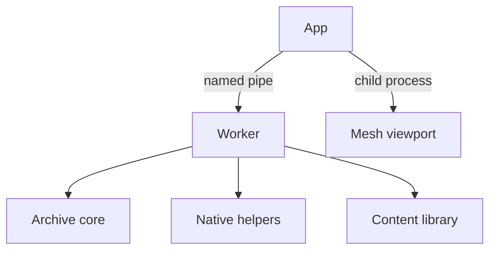
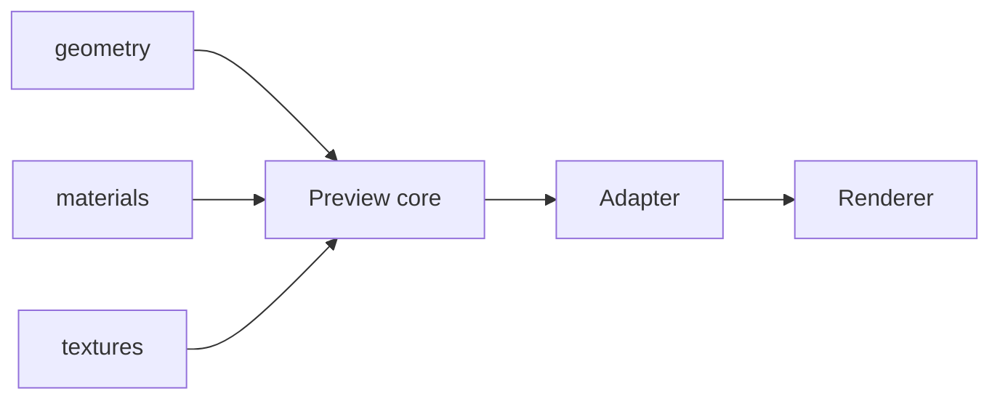

# CDMW Archive Lite

[](https://github.com/Ratty123/CDMW-Lite/actions/workflows/archive-lite.yml)


CDMW Archive Lite is a standalone, read-only Windows desktop application for browsing Crimson Desert PAMT/PAZ archives. It can search, inspect, preview, and export archive content without modifying the source archives.

The application is self-contained in this repository and keeps archive queries, decoding, media conversion, and mesh rendering outside the UI process.

## Download and run

[Download the latest release](https://github.com/Ratty123/CDMW-Lite/releases/latest) for Windows 11 x64. Both packages include the required runtime; no separate .NET or Python installation is needed.

- **Standalone EXE:** download `CDMW-Archive-Lite-1.2.0-Standalone-win-x64.exe` to a writable folder and run it. The first launch extracts and verifies the bundled runtime; later launches reuse it.
- **Portable ZIP:** extract `CDMW-Archive-Lite-1.2.0-win-x64.zip` and run `CdmwArchiveLite.exe` from the extracted folder. Keep its companion files and folders together.

Open your Crimson Desert installation or archive folder, then build or reuse its index. Use Item Finder for equipment names and Body & Face Finder for character assets and appearances. Select a separate output folder when exporting.

## New in 1.2.0

- Read-only support for the October 2026 DLC's compact archives and mount tables, including updated partial PAM and PAMLOD model decoding.
- Ship equipment, blueprint and material categories, plus an **Only DLC items** filter for newly introduced items.
- Merged base and DLC item and character names, ship inventory icons, and nested prefab/PAMI model links. Base translations remain available when DLC tables omit them.
- Character previews can use rigs declared by their own or family descriptors. PAMLOD material names no longer create false mesh parts, and Abyss socket gear stays out of wearable armor categories.
- Automatic refresh of older Finder and model-preview caches.

See [CHANGELOG.md](CHANGELOG.md) for the full release details.

## Highlights

- Browse large archives through a folder tree or a flat list, with an optional category navigator, paging, filters, sorting, and persistent indexes.
- Search text across archives or loose folders with cancellation, result limits, and in-file navigation.
- Find known items by localized name and follow exact or related archive links.
- Item Finder reads the active mounted item and localization tables, including compressed `item.paloc` languages. Distinct item IDs remain separate and items without model links stay searchable. Earlier item-name caches rebuild automatically, and unreadable languages are reported without hiding valid languages.
- Body & Face Finder browses unique model assets and named appearances, with Bodies/Faces views, filters, thumbnails, an interactive 3D preview, and exact or related files in the archive browser. Unresolved and ambiguous appearances remain searchable with their evidence.
- Preview text, XML, images, DDS textures, supported media including the sounds a Wwise `.bnk` embeds, archive metadata, and read-only PAC/PAM/PAMLOD/PAT geometry.
- Export a mesh as OBJ, GLB or FBX, preserving source coordinates, vertex order and material parts. A resolved skinned character carries its skeleton and all eight per-vertex influences into GLB and FBX.
- Discover and export associated assets without altering game data.
- Run as a portable Windows application or a single self-extracting executable.
- Switch the interface between the fourteen languages Crimson Desert itself ships; every one but English is machine translated and unreviewed.
- Keep settings, caches, logs, and crash reports isolated from the full CDMW workbench.

The October 2026 DLC archive layouts are supported for read-only browsing, previews and exports.
Open the complete game installation to include `dlc/dlc_01` and its mount table. Item Finder merges
base and DLC tables, resolves ship inventory icons and nested prefab model links, and provides
Ships categories and an **Only DLC items** filter. That filter includes newly introduced item IDs;
base-game items updated by DLC remain in the normal catalogue. Clear resets the filter.
Body & Face Finder merges base and DLC character names while retaining base translations omitted
by DLC tables. Earlier Finder and model-preview caches rebuild automatically.

Missing installed icons, textures or model references remain unavailable. The compact mount
table's authentication trailer is treated as opaque metadata; Lite does not modify archives.
Compatibility is covered by synthetic fixtures, not a new real-game or visual acceptance run.

Body & Face Finder builds its catalogue and previews in the worker and renderer processes. Pages contain at most 72 rows. Thumbnails appear individually with loading indicators and cancellation; up to four following pages preload in the background, with eight pages of bounded in-memory reuse. Appearance previews preserve component placement and authored scale, and bodies with an embedded face avoid adding a second head. Customization, morphs and animation are not applied; their descriptors remain available for inspection or export.

## Safety boundary

Archive Lite has no archive-write, replacement, patching, backup, restore, or mod-building authority. PAMT, PAZ, and PATHC sources are opened read-only, and exports are written to a separate destination selected by the user.

The repository does not contain game archives, extracted game assets, or other local game data.

## Build requirements

These tools are needed only when building from source:

- Windows 11 x64
- .NET 10 SDK
- CMake 3.24 or newer
- Visual Studio 2022 Build Tools with the Desktop C++ workload
- PowerShell

Pinned third-party sources are documented in [DEPENDENCY-SOURCES.md](DEPENDENCY-SOURCES.md).

## Run from source

First run the focused nonvisual gate:

```powershell
.\scripts\test_archive_lite.ps1 -Configuration Debug
```

Then launch the desktop application:

```powershell
dotnet run --project .\src\Cdmw.ArchiveLite.App\Cdmw.ArchiveLite.App.csproj -c Debug
```

The launch command opens a visible desktop window and is intentionally separate from automated validation.

## Build

For a fresh standalone executable, run:

```text
BUILD-FRESH-EXE.bat
```

For the complete verified Release package:

```powershell
.\scripts\build_archive_lite.ps1
```

Build outputs are written beneath the ignored `artifacts/` directory. On a clean checkout, pinned native dependencies are downloaded into the ignored `.tools/` directory.

## Architecture



| node | process or library | responsibility |
| --- | --- | --- |
| App | `CdmwArchiveLite.exe` | WPF presentation and selection state |
| Worker | `CdmwArchiveLite.Worker.exe` | archive queries, search, preview, export |
| Mesh viewport | `cdmw-mesh-dotnet-editor.exe` | read-only Vortice D3D11 rendering |
| Archive core | `cdmw-archive-core.dll` | read-only PAMT / PAZ / PATHC decoding |
| Native helpers | helper processes | indexing, DDS, model and media preparation |
| Content library | managed | semantic archive documents |

The named pipe carries request IDs and cancellation. The UI owns presentation; long-running work stays cancellable in the worker or a dedicated native process, and the renderer runs in its own child process.

## Model preview

A model preview is assembled from the geometry, its material sidecar, and the textures those materials name. Crimson packs surface response into one map, so the preview reads the channels rather than guessing from a filename.



`.pac` geometry, the `.pac_xml` material sidecar, and the `.dds` textures it names go to the preview core, which assigns each binding a role, selects a slot per submesh, and resolves colour layers. The adapter turns that into channels, packed components, and layer bindings; the renderer samples them.

Blended colour and surface maps use the largest active source texture or selector mask, capped at 2048 pixels with its aspect ratio preserved. Small base swatches do not reduce detailed overlays to swatch size. The compositor keeps the base alpha and samples image edges without introducing transparent borders; direct DDS textures retain their source resolution and mip chains.

Display textures prepares large layered maps in the renderer process using up to four CPU workers. Repeated layer inputs reuse a bounded sampling cache, avoiding redundant bitmap conversions while preserving layer order and the resulting pixels.

Body & Face Finder shows geometry first while an uncached model's full textures prepare. Cached textured models open directly. Its interactive renderer warms when the dialog opens, and the thumbnail queue reuses a separate hidden D3D11 device instead of starting one process per card. Two visible requests overlap archive preparation with rendering; subsequent pages preload at lower priority. Thumbnail material composites are capped at 256 pixels for the 160-pixel cards. Interactive previews retain the full 2048-pixel composite limit and original DDS mip chains. Cancelling a render stops its helper, and an idle thumbnail helper exits after 30 seconds.

| suffix | role | notes |
| --- | --- | --- |
| `X.dds` | albedo | the part's own colour |
| `X_n.dds` | normal | two-channel BC5; Z is rebuilt |
| `X_sp.dds` | surface response | **G** roughness, **B** metalness |
| `X_ma.dds` | colour-blending mask | selects among colour layers, not a response map |
| `X_emi.dds` | emissive intensity | single-channel BC4; the colour is authored, not sampled |
| `X_disp.dds` | height | |
| `X_f.dds` | strand direction | orients the anisotropic hair highlight |

The material audit recorded on 2026-09-19 covered ten assets, 50 parts and 60 Lite captures: all 3,160 declared material parameters were retained, no declared textures were unresolved, and 694 shared DDS comparisons matched byte-for-byte. This is sampled evidence, not a claim of identical lighting or complete game coverage. [PREVIEW-MATERIAL-AUDIT.md](PREVIEW-MATERIAL-AUDIT.md) records the method and historical corpus measurements separately; those older measurements do not validate the current compositor.

## Mesh export

A PAC, PAM, PAMLOD or PAT mesh exports as OBJ, GLB or binary FBX. Exports preserve source
coordinates, vertex order (including unused vertices), and material parts. PAMLOD parts retain
their individual materials and local face indices. GLB uses float coordinates; OBJ and FBX use
the package's double-precision source geometry when available.

| | OBJ | GLB | FBX |
| --- | --- | --- | --- |
| geometry, in the archive's own units and order | yes | yes | yes |
| material names, and a material library | `.mtl` | material per part | material per part |
| matching selected diffuse textures | relative MTL reference | not embedded | relative FBX reference |
| armature and per-vertex weights | — | yes | yes |
| bones written | — | those the mesh uses, plus their ancestors | the whole skeleton |
| round-trip sidecar naming the source entry | `.obj.meta.json` | — | — |

Geometry is in game units, and a game unit is a metre: a character body measures 1.84 tall in all
three. The FBX declares this rather than leaving an importer to assume centimetres.

Only a skinned `.pac` carries a rig. A rigidly bound mesh — a prop, an accessory, a vehicle — puts
its whole weight on one influence and records no bone anywhere in the file, so the bone it follows
is not the mesh's to state; it exports unrigged. So does a smooth-skinned mesh whose bone palette
no skeleton named by its own path accounts for, which is most NPC and monster gear. The preview
package records which of those cases it found and why.

PAC normals follow the game's signed-z reconstruction. Rigged exports normalize all eight
influences together, including the two gated half-float palette slots; older six-influence
preview packages remain readable. Newly built packages use a fresh cache version. Malformed
declared geometry, identity or skin buffers fail export instead of silently losing data. Skin
tables must cover every exported source vertex.

An export selection is prepared in a staging directory, including selected referenced files,
the OBJ material library and metadata. Failed preparation or cancellation leaves existing
outputs intact. Publication restores prior outputs if a file replacement fails. Material
references are relative to each mesh's own directory. An authored texture name wins over
material-name guesses; ambiguous names and normal/surface-map prefixes are not used as diffuse
fallbacks. Known no-texture placeholders are omitted, allowing a matching real diffuse companion
to supply the binding. Cancel applies to existing companions as well as the mesh itself. If the
mesh is skipped or the selection is cancelled, unpublished companions are reported accordingly.

The parity review used CDMW Full through `8527abd0`: PAC normal/eight-influence corrections
(`fc0e3207`), PAMLOD materials and complete export publication (`67142896`), partial PAM decoding
(`aeecff9f`), and native FBX texture/shape output (`ff67ac31`, `68b265a1`). Lite retains source-space
OBJ output, matching Full's default after `8ec50f1b`. Full's DAE/glTF/FBX/OBJ replacement-import
workflows and optional PABC/PAMT neutral-appearance reconstruction are separate authoring
features; Lite does not acquire archive-writing or model-replacement authority from this port.

`scripts/blender/` holds a headless script that imports an export, checks every vertex is weighted
and sums to 1.0, poses a bone and asserts the vertices that moved are the ones near it. It is not
part of the focused gate, since it needs Blender and licensed game assets.

## Validation

`scripts/test_archive_lite.ps1 -Configuration Debug` checks synthetic archive reads, Item Finder and Body & Face Finder, material composition, OBJ/FBX/GLB exports, cache reuse, cancellation, worker lifetime and hidden D3D11 renderer behavior. The runner reports the current scenario count.

`scripts/build_archive_lite.ps1` repeats the focused checks in Release and verifies the packaged application, native helpers, renderer and standalone launcher, including first-run extraction and cached startup. These checks do not establish real-game performance, full-corpus material fidelity or Blender import behavior for every asset. See [TESTING.md](TESTING.md) for coverage and separate validation requirements.

## Repository layout

- `src/` — WPF application, worker, shared contracts, and managed archive services
- `native/` — read-only archive and preview implementations
- `tools/` — repository-owned helper and renderer projects
- `tests/` — managed regression coverage and synthetic fixtures
- `scripts/` — focused validation and packaging entry points
- `schemas/` — versioned repository-owned data contracts
- `.github/` — GitHub Actions, dependency update configuration, and collaboration templates

## Local data

Portable builds keep settings, caches, logs, and crash reports beside the executable. The single-file launcher extracts its verified runtime beneath `%LocalAppData%\CDMW\CDMWArchiveLite\standalone\`; it does not place user settings, game data, or exports there.

These paths and all build outputs are excluded from version control.

Neither package is code-signed. Security software may flag an unsigned self-extracting executable. Release notes include SHA-256 hashes for checking downloaded files. The portable ZIP contains the same application as ordinary files and can be used without the self-extracting launcher.

## Project documents

- [TESTING.md](TESTING.md) - validation matrix and proof boundaries
- [PREVIEW-MATERIAL-AUDIT.md](PREVIEW-MATERIAL-AUDIT.md) - how a preview is checked against its source, what is confirmed authored, and which explanations were refuted
- [CONTRIBUTING.md](CONTRIBUTING.md) - development and review expectations
- [SECURITY.md](SECURITY.md) - supported versions and private reporting
- [CHANGELOG.md](CHANGELOG.md) - notable version changes
- [THIRD-PARTY-NOTICES.md](THIRD-PARTY-NOTICES.md) - bundled component notices

## License

[MIT](LICENSE). Bundled third-party components keep their own licences, listed in
[THIRD-PARTY-NOTICES.md](THIRD-PARTY-NOTICES.md).

Archive Lite reads game files that it never ships. It contains no Crimson Desert content, and the
archives it opens stay read-only. Whatever you export from your own installation remains subject to
the game's own terms.
